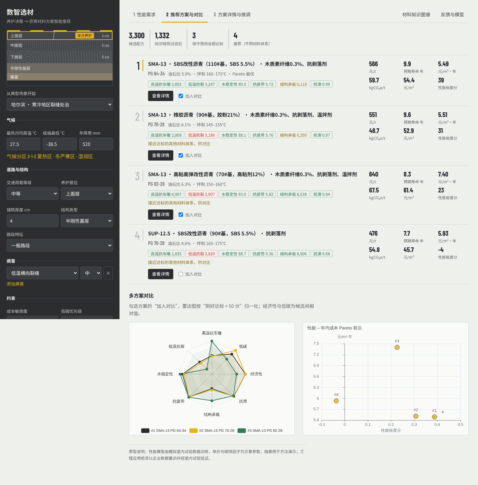

# 数智选材 · 沥青材料方案智能推荐引擎

第十二届中国研究生智慧城市技术与创意设计大赛 · 企业揭榜赛道 **HY-01「数智选材——AI 驱动的道路养护决策与沥青材料方案智能推荐系统」** 参赛原型。

> 作品提交截止：**2026 年 10 月 25 日中午 12:00**（大赛官网 cpipc.acge.org.cn）。作品各部分（含文件名）不得出现培养单位、指导教师等身份信息。

养护决策系统告诉你“修什么”，本系统回答“用什么材料修、为什么、预期效果如何”：

```
养护场景 ─▶ 性能需求（可追溯） ─▶ 候选配方 + 知识规则过滤 ─▶ 多性能预测（含区间与归因）
        ─▶ 保守校核 + 多目标评分 ─▶ Top-K / Pareto / 施工工艺建议 ─▶ 人工微调确认 ─▶ 试验与路用反馈
```



## 快速开始

```bash
pip install -r requirements.txt
python scripts/train.py             # 生成 160 条模拟试验数据并训练模型（约 5 秒）
uvicorn smartmix.api:app --port 8000
# 浏览器打开 http://127.0.0.1:8000 ，接口文档 http://127.0.0.1:8000/docs
```

首次启动若没有模型文件会自动训练。前端依赖全部在本地（`smartmix/web/static/`），断网或内网也能完整演示。

```bash
python -m pytest                    # 21 项测试
python scripts/run_cases.py         # 重新生成 7 个典型场景的验证报告
```

## 仓库结构

| 路径 | 内容 |
|---|---|
| `smartmix/requirements.py` | 场景标签体系、气候分区、场景 → 性能需求映射与权重（含推导轨迹）、7 个典型场景预设 |
| `smartmix/kb/` | 材料参数表、“材料组成—性能表现—适用场景”知识图谱与工程规则（JSON，可由材料工程师直接维护） |
| `smartmix/knowledge.py` | 结合料 PG 计算、候选空间枚举、规则推理、知识图谱构建与推理路径 |
| `smartmix/data.py` | 特征工程、可加机理先验、模拟数据生成器 |
| `smartmix/model.py` | 机理—数据混合预测模型（集成、区间、SHAP 归因、持久化） |
| `smartmix/recommender.py` | 推荐引擎：规则过滤、保守校核、多目标评分、Pareto、多样化 Top-K、工艺协同 |
| `smartmix/economics.py` | 单价、碳排（A1–A3）、预期寿命估算 |
| `smartmix/feedback.py` | 室内试验回流重训、路用寿命贝叶斯校正 |
| `smartmix/schemas.py` / `api.py` | 接口规范（Pydantic）与 HTTP 服务 |
| `smartmix/web/` | 交互界面 |
| `cases/` | 典型案例与经验方案、验证结果 |
| `docs/` | 项目说明书、项目简表、案例验证报告、接口规范、界面截图 |
| 根目录 PDF / 图片 | 大赛参赛指南与各企业揭榜赛题原始材料 |

## 数据声明（答辩时请如实陈述）

- 当前**没有企业实测数据**。训练数据由 `smartmix/data.py` 的生成器构造：依据规范与文献量级设定、带非线性与交互作用、加入试验噪声，并刻意与机理先验不完全一致，用于检验混合模型的修正能力。
- 材料单价、碳排因子为示意参数；寿命模型是待路用数据校准的假设，案例报告中“年均成本/寿命”改善幅度偏乐观。
- 这些都是可替换的数据层：接入企业脱敏数据后执行 `/api/v1/feedback/lab` 或替换 `data/lab_records.csv` 并重训，模型与推荐流程不变。

## 主要结果（模拟数据）

- 160 条样本训练，独立测试集 R²：动稳定度 0.93、低温应变 0.82、疲劳 0.83、动态模量 0.88。
- 小样本消融（40 条）：动稳定度 R² 混合模型 0.90，纯数据模型 0.58，仅先验 0.37。
- 7 个典型场景：推荐方案虚拟真值校核 7/7 满足全部硬性指标，经验方案 4/7。详见 [`docs/案例验证报告.md`](docs/案例验证报告.md)。

## 提交前待办

- [ ] 团队信息、已有基础写入 `docs/项目说明书.md` 与 `docs/项目简表.md`
- [ ] 请企业材料工程师复核 `cases/cases.json` 中的经验方案与 `smartmix/kb/` 中的参数
- [ ] 如能拿到企业脱敏数据，回流重训后重跑 `scripts/run_cases.py`
- [ ] 将说明书、简表转为 Word/PDF 按官网要求提交，源代码与截图作为补充材料
